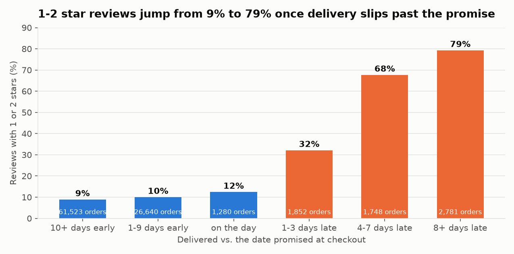
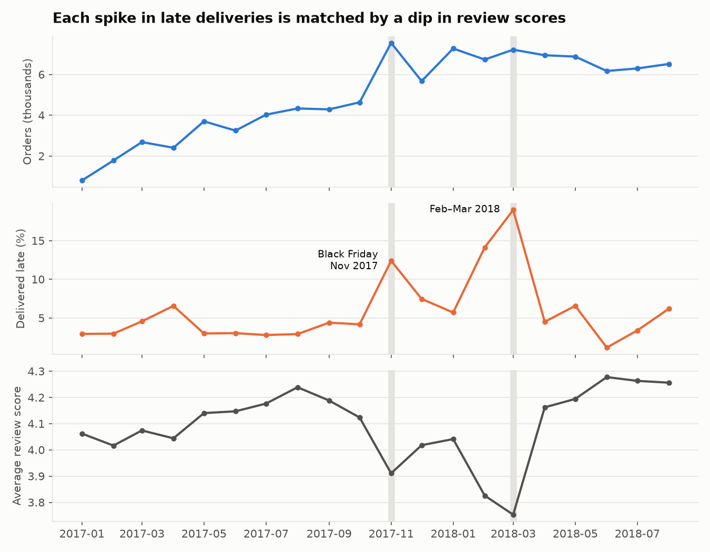
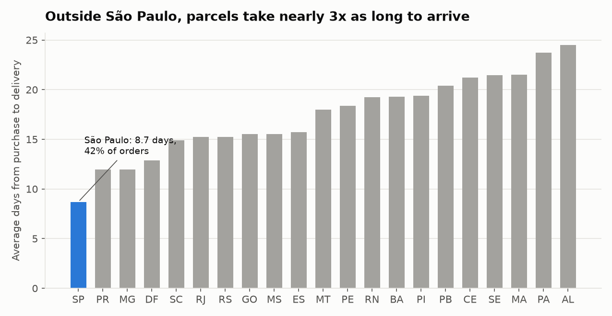

# Olist marketplace: a tested dbt + DuckDB warehouse

**A late parcel turns a happy customer into an angry one: 62% of late orders get a 1–2 star review, against 9% of on-time ones. This dbt project builds the warehouse that shows it, with 59 data tests run on every push.**


## Problem

Olist is a Brazilian marketplace that connects small sellers to big shopping sites. Its public data is 100k orders over two years, split across seven raw tables. Analysts who query those tables directly hit the same traps again and again:

- duplicate reviews for the same order
- category names in Portuguese
- order totals that don't match payments
- two different customer IDs for the same person

This project turns the raw tables into tested, documented marts that anyone can query. It then uses them to answer one question: **what drives bad reviews, and what should operations fix first?**

## Data

The data is the [Brazilian E-Commerce Public Dataset by Olist](https://www.kaggle.com/datasets/olistbr/brazilian-ecommerce): about 99k orders from Sep 2016 to Oct 2018, released under CC BY-NC-SA 4.0.

- `scripts/download_data.py` fetches the seven CSVs from a public GitHub mirror and checks each file's SHA-256, so CI builds from exactly the same bytes every time.
- The English category names come in as a dbt seed.
- Sep 2016 and Sep–Oct 2018 are partial months, so the charts leave them out.

## Approach

```mermaid
flowchart LR
    subgraph raw["raw (CSV, read in place)"]
        r1[orders] & r2[order_items] & r3[payments] & r4[reviews] & r5[customers] & r6[products] & r7[sellers]
        s1[(seed: category<br/>translation)]
    end
    subgraph staging["staging (views)"]
        st1[stg_orders] & st2[stg_order_items] & st3[stg_order_payments] & st4[stg_order_reviews<br/>deduped] & st5[stg_customers] & st6[stg_products<br/>translated] & st7[stg_sellers]
    end
    subgraph marts["marts (tables)"]
        f1[fct_orders] & f2[fct_order_items]
        d1[dim_customers] & d2[dim_products] & d3[dim_sellers]
        m1[mart_monthly_kpis] & m2[mart_delivery_reviews] & m3[mart_category_performance]
    end
    raw --> staging --> marts --> out[charts + Streamlit dashboard]
```



### The three layers

- **Raw.** The CSVs are declared as dbt sources and read in place with DuckDB's `read_csv`. Nothing is copied.
- **Staging (7 views).** One model per source table. They rename columns, cast types, and clean values (trim cities, upper-case states, translate categories).
  - Reviews are deduplicated to one per order: the most recently answered one.
- **Marts (8 tables).**
  - `fct_orders` has one row per order with:
    - basket and payment totals
    - main payment type
    - delivery days
    - days late vs. the promised date
    - review score
  - Dimensions for customers, products and sellers. `dim_customers` is keyed on `customer_unique_id`, the real person.
  - Three reporting marts: monthly KPIs, reviews by delivery timing, and category performance.

### Tests (59, run by `dbt build` and in CI)

| Kind | What it guards |
|---|---|
| `unique` + `not_null` | Every primary key in staging and marts |
| `relationships` | Orders → customers; items → orders, products, sellers; payments and reviews → orders; facts → dimensions |
| `accepted_values` | Order status, payment type, review score 1–5, all 27 Brazilian state codes |
| Singular: `assert_delivery_after_purchase` | No parcel arrives before it was bought |
| Singular: `assert_order_totals_reconcile` | Payments match items + freight within R$1. Warns on any mismatch and fails above 500. Today 247 orders (0.26%) warn, mostly voucher top-ups. |

The latest build gave PASS=74, WARN=1, ERROR=0.

## Results

### 1. Late delivery is what wrecks reviews



| Delivered vs. promise | Orders | Avg review | 1–2 star share |
|---|---:|---:|---:|
| 10+ days early | 61,523 | 4.32 | 8.9% |
| 1–9 days early | 26,640 | 4.23 | 10.0% |
| On the promised day | 1,280 | 4.03 | 12.4% |
| 1–3 days late | 1,852 | 3.29 | 32.1% |
| 4–7 days late | 1,748 | 2.10 | 67.7% |
| 8+ days late | 2,781 | 1.70 | 79.3% |

Only 6.8% of the 96,478 delivered orders were late, yet they account for most of the angry reviews. The damage starts within the first three days of slipping.

### 2. Bad months were delivery failures, not demand



Two months drove most of the late deliveries:

- **Black Friday, Nov 2017:** late share rose to 12.4%.
- **Feb–Mar 2018:** late share hit 19.0%, and the average review fell to 3.75, the lowest in the data.

Order volume was flat to rising across both periods, so each review dip lines up with a delivery spike rather than a change in demand.

### 3. Distance is the delivery problem



São Paulo receives 42% of orders, and they arrive in 8.7 days on average. In the North and Northeast, delivery takes 18–25 days; Alagoas (AL) is the slowest at 24.5 days.

### Other numbers from the marts

| Metric | Value |
|---|---:|
| Distinct customers | 96,096 |
| Customers who ordered more than once | 3.1% |
| Total lifetime value | R$15.42M |
| Top category by revenue | health_beauty (R$1.23M) |
| Second category | watches_gifts (R$1.17M) |

## Recommendations

1. **Protect the promise date before it slips.**
   - Flag orders whose carrier scan suggests they will miss the estimate.
   - Message the customer before the date passes.
   - The cliff is between "on time" (12% bad reviews) and "1–3 days late" (32%), so even a small rescue there pays off.
2. **Pad estimates for the North and Northeast instead of promising São Paulo speed.** Early deliveries earn the best reviews (4.32), so a longer, honest estimate costs little.
3. **Plan carrier capacity for peaks.** Black Friday and Feb–Mar 2018 both broke delivery. Book extra capacity ahead of known peaks and watch `mart_monthly_kpis.late_share` weekly.
4. **Treat retention as the next problem.** Only 3.1% of customers come back. Late deliveries likely feed that, so the next model to add is repeat purchase vs. first-order delivery experience.

## How to run

```bash
python -m venv .venv
```

```bash
source .venv/bin/activate        # Windows: .venv\Scripts\activate
```

```bash
pip install -r requirements.txt
```

```bash
python scripts/download_data.py  # ~60 MB into data/raw/, checksums verified
```

```bash
export DBT_PROFILES_DIR=.        # Windows PowerShell: $env:DBT_PROFILES_DIR="."
```

```bash
dbt build                        # seed + 15 models + 59 tests -> olist.duckdb
```

```bash
python scripts/make_charts.py    # writes reports/figures/*.png
```

```bash
streamlit run dashboard/app.py
```

Run `dbt docs generate && dbt docs serve` to browse the lineage graph and column docs.

## Demo

The Streamlit dashboard (`dashboard/app.py`) opens `olist.duckdb` read-only. It shows:

- a month-range filter
- KPI tiles: delivered orders, revenue, late share, average review
- monthly late share and review score
- 1–2 star share by delivery timing
- delivery days by state
- the top categories table

## Project layout

```
models/staging/     7 views + sources and tests
models/marts/       8 tables + tests
tests/              2 singular data tests
seeds/              category name translation
macros/             schema naming
scripts/            data download, chart generation
dashboard/          Streamlit app
.github/workflows/  CI: download -> dbt build -> charts
```

## License

The code is MIT. The data belongs to Olist, under CC BY-NC-SA 4.0.
